# 👋 Hey, I'm Rohan Basnet

### 🚀 Data Enthusiast | Data Engineering | Analytics | AI

Exploring the world of data, building projects, and continuously learning.

---

## 🐍 Feed Me, I'm Still Hungry!

---

## 📊 GitHub Statistics

## 📊 GitHub Stats

---

## 📈 Top Languages

---

## 📈 Contribution Activity

---

## 🚀 Featured Projects

- 🚀 **Social Media Data Engineering Project** — In Progress
- 📊 **SQL Data Warehouse** — Medallion Architecture & Star Schema

---

## 🧠 Tech Stack

### 🐍 Languages & Query

### ⚡ Big Data & Processing

### ☁️ Data Platforms

### 📊 Analytics & Visualization

### 🤖 AI & Machine Learning

---

## 📫 Connect With Me

- 💼 LinkedIn: [Rohan Basnet](https://www.linkedin.com/in/rohan-basnet-74b95b305/)
- 📧 Email: [rohbas05@gmail.com](mailto:rohbas05@gmail.com)
- 🐙 GitHub: [Rohan-Basnet](https://github.com/Rohan-Basnet)

---

### 💡 Learn. Build. Break. Fix. Repeat.

